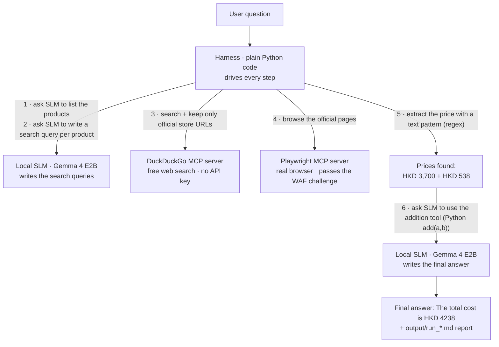

# SLM_For_Web_Search

**A fully local, zero-cost "ask → search the web → answer" pipeline powered by a small language model (SLM) and MCP servers — no API keys, no cloud, no scraping code to maintain.**

## Background

The end goal of this project: give a **small language model running entirely on your own computer** the ability to **search the web for the user** and answer a real, practical question:

> *"How much does it cost to buy a Nintendo Switch 2 and a Pro Controller in Hong Kong?"*

This is the familiar behavior of big cloud assistants: you ask a question, the assistant quietly calls a search API, reads the results, and answers with current, real-world information. This project explores whether that *entire experience* can be reproduced **locally** — a ~2B-parameter model (small enough to run even without a GPU) combined with free MCP web-search tools — at **zero cost**, with no API keys and no cloud services.

Along the way, the project became a hands-on study of small-model limits: what a 2B model reliably *can* do (write a short search query, list product names, phrase one sentence) and what it clearly *cannot* (arithmetic, multi-step planning, staying on task). Everything you see here — the "code-first harness" architecture — is the result of that exploration, and the [study guide](docs/study_guide.md) documents every step of the journey.

## Demo — what the finished pipeline does

Ask the demo question:

> *"If I buy the Nintendo Switch 2 console and a Nintendo Switch 2 Pro Controller in Hong Kong, how much will they cost in total?"*

Get (built live from the official store's pages, running entirely on your machine):

> **The total cost is HKD 4238.**

…plus a complete [run report](output/run_20261018_152058.md) that records every step, every tool call, and every decision — written automatically to `output/run_<timestamp>.md` at the end of each run.



---

## The core idea

Answering questions about *current* web data normally means building and maintaining a full search + scraping stack by hand (proxies, JavaScript challenges, anti-bot defenses — a never-ending job). This project takes a different route:

1. **Borrow abilities from the MCP ecosystem instead of building them.** Two existing MCP servers cover the whole web-search flow:
   - **`duckduckgo-mcp-server`** → free web search (`search`), no API key.
   - **`@playwright/mcp`** → a real browser (`browser_navigate`, `browser_evaluate`).
2. **Know why both are needed.** The DuckDuckGo server's `fetch_content` tool is a *plain page downloader* — it downloads the page like a plain file and never runs the page's JavaScript. The official Nintendo Hong Kong store sits behind an **AWS WAF JavaScript challenge** (a security check that only works if JavaScript runs): plain downloaders receive a challenge page and **0 useful content** (verified during development). Only a real browser passes it. So: search with DuckDuckGo, read pages with Playwright — each server covers the other's weakness.
3. **Drive the tool combination with a local SLM.** The pipeline reproduces the familiar "LLM searches the web and answers" experience at **zero cost**, fully offline except the web requests themselves.
4. **Be honest about small-model limits.** Development showed that the 2B model cannot work like an independent agent — one that plans and completes the whole task alone: it fails at arithmetic, ignores list requests, and gets confused by system prompts. The final architecture is therefore a **code-first harness**: the SLM does only three small text jobs (list the products, write search queries, write the final sentence — using the *addition tool*, the tiny Python `add(a, b)` function, for the math), and **code forces everything else** — searching, URL filtering, browsing, price extraction, retries, adding up the prices, reporting. The full debugging story (rounds a→b→c→d) is in [Chapter 4.6 of the study guide](docs/04_mcp_tool_calling.md#46-the-small-model-limitation-story).

## Why this model?

`gemma-4-E2B-it` compressed ("quantized") to **UD-Q2_K_XL** (from [unsloth/gemma-4-E2B-it-qat-GGUF](https://huggingface.co/unsloth/gemma-4-E2B-it-qat-GGUF)): a ~2B-parameter model ("parameters" are the numbers inside the model — more means smarter but heavier) made small enough to run on an **ordinary CPU laptop**. The point: *anyone* — with or without a GPU — can reproduce this project's results, or use the same small model as a starting point for exploring what local SLMs can do.

## What the final run produces

Every run ends with a Markdown report in [`output/`](output/): which MCP servers started and *all* tools they offered, a numbered table of every MCP tool call (arguments, output, duration), an 18-step timeline with **"Who did what"** (Harness vs. SLM) and the exact tool used per step, the extracted price data as JSON, and the final reply. See the example: [`output/run_20261018_152058.md`](output/run_20261018_152058.md).

---

## Getting started

Full beginner-friendly instructions: **[docs/00_environment_setup.md](docs/00_environment_setup.md)** — or, if you just want a short checklist of commands, **[project_setup.md](project_setup.md)**. The short version:

```powershell
# 1. Python environment (Python 3.12+, we used 3.14)
uv venv --python 3.14
uv pip install -r requirements.txt

# 2. The Playwright MCP server is a Node package (no Python SDK exists)
npm install -g @playwright/mcp
```

**3. Download the model file** — click the link below, then save the file as `model/gemma-4-E2B-it-qat-UD-Q2_K_XL.gguf`:

> **[➜ Download gemma-4-E2B-it-qat-UD-Q2_K_XL.gguf](https://huggingface.co/unsloth/gemma-4-E2B-it-qat-GGUF/resolve/main/gemma-4-E2B-it-qat-UD-Q2_K_XL.gguf?download=true)**

```powershell
# 4. Verify: both MCP servers should start and list their tools
uv run --python ".venv" python -X utf8 src/mcp_client.py

# 5. The full pipeline (~15-20s per run) → answer + report in output/
uv run --python ".venv" python -X utf8 -u src/mcp_tool_calling.py
```

> Always include `-X utf8`: on Windows systems with a GBK console, redirected output crashes on non-GBK characters without it ([why](docs/05_troubleshooting.md#51-encoding-crashes-on-windows-unicodeencodeerror-gbk)).

## Repository layout

| Path | Description |
|---|---|
| [`src/basic_chat.py`](src/basic_chat.py) | Step 1: talk to the local SLM (JSON-forced answers, memory) |
| [`src/basic_tool_calling.py`](src/basic_tool_calling.py) | Step 2: teach the SLM to call Python tools (pretend prices) |
| [`src/mcp_client.py`](src/mcp_client.py) | Step 3: connect to both MCP servers, list their tools |
| [`src/mcp_tool_calling.py`](src/mcp_tool_calling.py) | Step 4: the full harness — the main program built in this project |
| [`docs/study_guide.md`](docs/study_guide.md) | **Complete tutorial** (chapters 0–5, with screenshots & experiments) |
| [`output/`](output/) | Generated run reports (Markdown, table-rich) |
| [`screenshot/`](screenshot/) | Reference screenshots used by the tutorial |
| [`model/`](model/) | Put the downloaded `.gguf` here |
| [`project_setup.md`](project_setup.md) | Short checklist of setup steps |

## Learning path

This repo is also a **tutorial series**. For Python beginners, read in order:

**[docs/study_guide.md](docs/study_guide.md)** — the hub, linking to:

0. [Environment setup](docs/00_environment_setup.md) — every tool, verified step by step
1. [Your first local SLM](docs/01_basic_chat.md) — `basic_chat.py` explained line by line
2. [Tool calling](docs/02_basic_tool_calling.md) — `@tool`, the two-stage pattern, the JSON-vs-tools conflict
3. [MCP client](docs/03_mcp_client.md) — connecting servers; the WAF discovery that shaped everything
4. [The full pipeline](docs/04_mcp_tool_calling.md) — harness design, price extraction, the md report, the small-model limitation story
5. [Troubleshooting](docs/05_troubleshooting.md) — every trap we hit, with fixes

## Key findings (the honest version)

- **A 2B SLM cannot do arithmetic reliably** (`2150 + 449` → it answered `2150` in every variant we tried). Fix: an *addition tool* — the Python function `add(a, b)` computes the exact total, the model just calls it. Never let a small model compute totals.
- **Small models need format examples, not long descriptions.** "List every product, one per line" produced only *one* line; a single example with different products (PS5!) fixed it 3 out of 3 runs.
- **A system prompt written for one job can ruin another job.** "You write short web search queries" broke the product-listing job; a neutral prompt fixed both.
- **JSON-schema samplers and tool calling cannot be used together** — the JSON grammar blocks the special tokens that tool calls need. Use two stages: tool chat (default sampler) + summary chat (schema sampler).
- **WAF-protected pages need a real browser.** DuckDuckGo's `fetch_content` (and other plain fetchers) cannot pass JavaScript challenges; Playwright can.
- **Give the SLM clean ASCII text only** (ASCII = plain English letters, digits, and punctuation). Page text that contained Chinese characters made the model invent facts (hallucinate); passing a single regex-extracted price text like `HKD 3,700` fixed it.

## Discussion — what a bigger model could change

Look back at the architecture diagram and notice how much of it is **forced by code**: the official-domain filter in the query, the URL selection (`official_product_urls()`), the price regex (a text pattern, `extract_price_line()`), the 3-attempt retry rule, the code-chosen final hint, and the code-computed total. None of that is what an "AI agent" is *supposed* to do — it is the harness making up for what a 2B model clearly cannot do ([Chapter 4.6](docs/04_mcp_tool_calling.md#46-the-small-model-limitation-story)).

That raises the natural question this project leaves open for you to explore:

> **With the same two MCP servers — `search` of `duckduckgo-mcp-server` plus `browser_navigate` + `browser_evaluate` of `playwright-mcp` — but a much larger SLM, could the code-hardcoded parts be removed entirely?**

A model with enough power could likely take over every harness job:

| Currently forced by code | With a bigger model |
|---|---|
| Code adds the official domain to every query | The model decides where to look and rewrites its own queries |
| Code keeps only official URLs from search results | The model reads the results and judges which sources are relevant and reliable |
| Code extracts the price with a regex (text pattern) | The model reads the page content itself and finds the answer |
| Code retries exactly 3 times | The model notices a failure and tries again when needed |
| Code computes the total via the *addition tool* | (Keep the tool anyway — letting *any* model do arithmetic in its head is still a risk) |
| Code chooses the final prompt for the model | The model plans its own steps from start to finish |

If most of those rows move from "code" to "model", the harness becomes a very thin loop that just passes tool calls along — and you get the real thing: **an LLM that hears the user's question, searches the web on its own, judges which information is trustworthy, and returns a reliable answer** — the same loop big cloud assistants run, except built on free MCP tools and a locally hosted model.

This is an idea to try, not a promise. The best part is that the **tool layer does not change at all**: the MCP client code, the `search_web` / `fetch_webpage` wrappers, and the report system all stay as they are. The model can be replaced whenever you want (nobodywho runs larger GGUF models in the same way), and the prompts and limits can be relaxed step by step as the model proves it can handle more. Some warnings still apply, though: bigger models still hallucinate (invent facts), and the WAF-protected store still needs the real browser no matter how smart the model is.

This project started on purpose from the **smallest** useful model, to find the lowest limit — the point where the code-first harness cannot be avoided. Replacing it with a bigger model is how you find the upper limit: how much of the harness becomes unnecessary. That experiment is left to you — the tools are ready.

## References

[MCP](https://modelcontextprotocol.io/) · [MCP client tutorial](https://modelcontextprotocol.io/docs/develop/build-client) · [nobodywho docs](https://docs.nobodywho.ai/python/) · [nobodywho tool calling](https://docs.nobodywho.ai/python/tool-calling/) · [nobodywho GitHub](https://github.com/nobodywho-ooo/nobodywho) · [duckduckgo-mcp-server](https://github.com/nickclyde/duckduckgo-mcp-server) · [microsoft/playwright-mcp](https://github.com/microsoft/playwright-mcp)

---

Made with ♥ Powered by DeepSeek-V4.1-Flash
