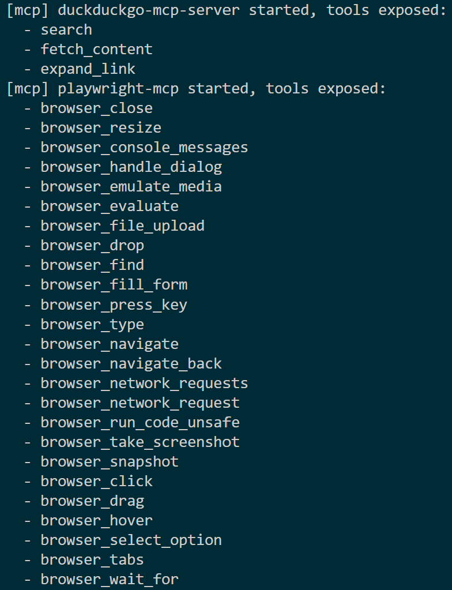

# Chapter 0 — Environment Setup

> **Part of the [study guide](./study_guide.md). Next chapter: [Chapter 1 — Your first local SLM](./01_basic_chat.md)**

This chapter takes you from a computer with nothing installed to a fully working setup where:

1. A local small language model (SLM) runs on your machine.
2. Both MCP servers used by this project can start and list their tools.
3. The final project script can run from start to finish.

Nothing here is optional. Take your time; every step has a check command so you always know whether it worked.

> **In a hurry?** There is a short, commands-only checklist in [`project_setup.md`](../project_setup.md). This chapter is the full version: it explains *why* each step exists and how to check it — start here if any command in the checklist fails.

---

## 0.1 What you are going to install

| Software | Why you need it | Where to get it |
|---|---|---|
| **VS Code** | A code editor with a built-in terminal and Python support | https://code.visualstudio.com/ |
| **Python 3.14** (3.12+ works) | Runs all Python code in this project | https://www.python.org/downloads/ |
| **uv** | A very fast Python package manager we use to create the venv and install packages | https://docs.astral.sh/uv/ |
| **Node.js (LTS)** | The Playwright MCP server is a Node.js package | https://nodejs.org/ |
| **Google Chrome** *(optional)* | Only needed if you want Playwright MCP to drive your own Chrome (`--browser chrome`). By default it uses its own bundled Chromium, downloaded automatically — no separate browser install required | https://www.google.com/chrome/ |
| **The model file** | The "brain": Gemma 4 E2B, a small compressed GGUF file | [Download page (Hugging Face)](https://huggingface.co/unsloth/gemma-4-E2B-it-qat-GGUF) |

You do **not** need a GPU. The model file chosen here is a small, heavily compressed one made specifically to run on an ordinary CPU. If you do have a GPU (e.g. NVIDIA), the engine that runs the model (nobodywho) will use it automatically through Vulkan and run faster.

---

## 0.2 Install VS Code

1. Download and install VS Code from https://code.visualstudio.com/.
2. (Optional but recommended) Install the Python extension:
   https://marketplace.visualstudio.com/items?itemName=ms-python.python
3. Open VS Code and open a terminal with `` Ctrl+` ``. All commands in this guide are typed into that terminal.

---

## 0.3 Install Python

1. Download Python 3.12 or newer from https://www.python.org/downloads/.
   The project was developed with **Python 3.14**.
2. **Important on Windows:** during installation, tick the checkbox **"Add python.exe to PATH"**.
3. Verify in the VS Code terminal:

```powershell
python --version
```

You should see something like `Python 3.14.x`. If the command is not found, reinstall Python and make sure PATH is enabled.

---

## 0.4 Install uv

`uv` is used to create the virtual environment and install the Python packages.

```powershell
pip install uv
```

Verify:

```powershell
uv --version
```

(If you prefer, uv also has a standalone installer — see https://docs.astral.sh/uv/getting-started/installation/.)

---

## 0.5 Install Node.js and the Playwright MCP server

Why Node.js? Because one of our two MCP servers — **Playwright MCP** — is a Node.js package published on npm. It has **no Python SDK**; there is no pip package for it. So:

1. Install **Node.js LTS** from https://nodejs.org/ (accept the defaults).
2. Verify in the terminal:

```powershell
node --version
npm --version
```

3. Install the Playwright MCP server globally:

```powershell
npm install -g @playwright/mcp
```

4. Verify that the `playwright-mcp` command exists:

```powershell
playwright-mcp --version
```

Useful reference URLs:

- GitHub: https://github.com/microsoft/playwright-mcp
- npm page: https://www.npmjs.com/package/@playwright/mcp
- Playwright's own MCP page: https://playwright.dev/docs/getting-started-mcp

### Browser options — you probably need none

Playwright MCP does **not** require a separately installed browser: it ships with its own **Chromium**, downloaded automatically on first use (on this machine: `%LOCALAPPDATA%\ms-playwright\chromium-*`). This project uses that default.

If you ever want a different browser, the official README (https://github.com/microsoft/playwright-mcp — *Configuration* section) documents the `--browser` option with possible values **`chrome`, `firefox`, `webkit`, `msedge`**, plus a few handy related flags:

| I want to... | Flag | Notes |
|---|---|---|
| Use my installed Google Chrome | `--browser chrome` | Chrome channel |
| Use Microsoft Edge | `--browser msedge` | Edge channel (preinstalled on Windows) |
| Use Firefox or WebKit | `--browser firefox` / `--browser webkit` | Playwright downloads these engines on demand |
| Use a custom browser binary | `--executable-path <path>` | e.g. a portable Chrome |
| Pretend to be a phone | `--device "iPhone 15"` | screen size + browser identity |
| Attach to an already-open Chrome/Edge | `--extension` | requires the "Playwright Extension" installed in that browser |
| Watch the browser working (not headless) | drop `--headless` | the server is headed by default; this project adds `--headless` |

If the included browser fails to download at first run (offline or an office network), fetch it manually:

```powershell
npx playwright install chromium
```

---

## 0.6 Create the project environment

All of the following is typed in the VS Code terminal, inside the folder where you cloned/copied this repository.

### Step 1 — create the virtual environment

```powershell
uv venv --python 3.14
```

This creates a `.venv` folder inside the project. A virtual environment keeps this project's packages separate from the rest of your system.

### Step 2 — install the Python packages

```powershell
uv pip install -r requirements.txt
```

Let's look at what gets installed, because every package has a job:

| Package | Job |
|---|---|
| `mcp` | The official **MCP client** library (Python). Lets our code connect to MCP servers with `Client` / `ClientSession`. Docs: https://modelcontextprotocol.io/ |
| `nobodywho` | The **engine that runs the model**: it loads the GGUF file and generates text. Docs: https://docs.nobodywho.ai/python/ · GitHub: https://github.com/nobodywho-ooo/nobodywho · PyPI: https://pypi.org/project/nobodywho/ |
| `duckduckgo-mcp-server[browser]` | The **DuckDuckGo search MCP server** (a Python package). GitHub: https://github.com/nickclyde/duckduckgo-mcp-server · PyPI: https://pypi.org/project/duckduckgo-mcp-server/ |

(Remember: the fourth "dependency", `@playwright/mcp`, is the Node package you installed with npm — it cannot be listed in `requirements.txt`.)

### Step 3 — download the model file

Download the model from Hugging Face — click this link to start the download:

> **[➜ Download gemma-4-E2B-it-qat-UD-Q2_K_XL.gguf](https://huggingface.co/unsloth/gemma-4-E2B-it-qat-GGUF/resolve/main/gemma-4-E2B-it-qat-UD-Q2_K_XL.gguf?download=true)**

(Prefer browsing the page first? Here is the repository it comes from: [unsloth/gemma-4-E2B-it-qat-GGUF](https://huggingface.co/unsloth/gemma-4-E2B-it-qat-GGUF).)

Then place it exactly here:

```
model/gemma-4-E2B-it-qat-UD-Q2_K_XL.gguf
```

(If the `model` folder does not exist, create it. The filename must match exactly — the code looks for this exact name.)

> **What is this file?** It is a **GGUF** model: a single file containing the whole neural network (the "brain"). `UD-Q2_K_XL` is a "dynamic 2-bit" quantization (compression method) from Unsloth — a compressed version that is small enough to run on an ordinary CPU laptop, and slightly less accurate than the full-size model. That is a fair trade: **anyone** with a normal computer can run this project.

---

## 0.7 Verify the environment (the fun step)

One command proves that Python, the packages, both MCP servers and Node are all set up correctly:

```powershell
uv run --python ".venv" python -X utf8 src/mcp_client.py
```

Expected output:



You should see both servers start and list their tools:

- `duckduckgo-mcp-server` offers: `search`, `fetch_content`, `expand_link`
- `playwright-mcp` offers: 25 `browser_*` tools (navigate, evaluate, click, …)

You will build this `mcp_client.py` step by step in [Chapter 3](./03_mcp_client.md).

> **Why `-X utf8`?** On a Chinese Windows system, the terminal uses an old text encoding called GBK (a Chinese character set from the 1990s). When output is written to a file, Python would use GBK by default — and any character GBK cannot represent (emoji, rare Chinese/Japanese/Korean characters) would crash the script with `UnicodeEncodeError`. `-X utf8` forces modern UTF-8 output everywhere. Use it on **every** run of this project. More details in [Chapter 5 — Troubleshooting](./05_troubleshooting.md).

---

## 0.8 You are ready

Checklist:

- [ ] `python --version` works
- [ ] `uv --version` works
- [ ] `node --version` and `npm --version` work
- [ ] `playwright-mcp --version` works
- [ ] `.venv` exists and `uv pip install -r requirements.txt` succeeded
- [ ] `model/gemma-4-E2B-it-qat-UD-Q2_K_XL.gguf` exists
- [ ] `src/mcp_client.py` prints both tool lists

When all of those are ticked, continue to **[Chapter 1 — Your first local SLM](./01_basic_chat.md)**.
