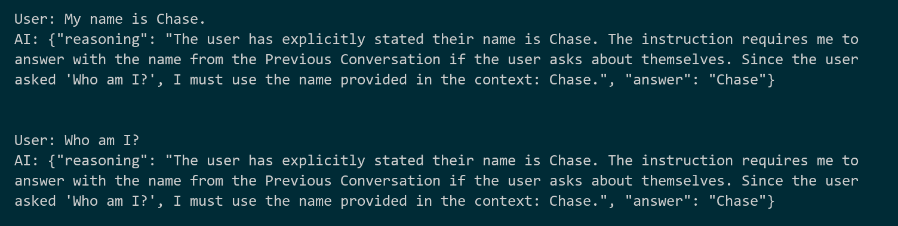

# Chapter 1 — Your first local SLM (`basic_chat.py`)

> **Part of the [study guide](./study_guide.md). Previous: [Chapter 0 — Environment Setup](./00_environment_setup.md) · Next: [Chapter 2 — Tool calling](./02_basic_tool_calling.md)**

In this chapter you meet the "brain" of the whole project: a small language model (SLM) that runs **on your own machine**, for free, offline. We put it inside a tiny Python class and teach it two tricks: forced thinking (JSON reasoning) and conversation memory.

```
src/basic_chat.py
```

---

## 1.1 Concepts you need first

| Term | Meaning in one line |
|---|---|
| **SLM / LLM** | The neural network that reads text and writes text (here: Gemma 4 E2B — 2.3B *effective* parameters, "small") |
| **GGUF** | A file format that packs an entire model into one file so it can run locally |
| **Quantization** | Compressing the model's numbers to fewer bits (we use "Q2", ~2-bit) → smaller file, runs on CPU, slightly dumber |
| **Token** | The unit models think in — roughly ¾ of a word. Everything (context, limits) is measured in tokens |
| **Context window (`n_ctx`)** | How many tokens the model can "keep in mind" at once, including the whole conversation |
| **Sampler** | The rules for picking each next token: how random (`temperature`), and what shape the output may have (JSON schema) |
| **System prompt** | The standing instruction that tells the model how to behave |

> **About the name "E2B":** the "E" stands for "effective". The model file holds about 5B numbers, but only **2.3B** of them ("effective parameters") do the heavy computing; the rest are large lookup tables that cost almost nothing to use. That is why a file this size runs as light as a 2.3B model.

Reference: nobodywho Python docs — https://docs.nobodywho.ai/python/ (chapters: Getting started, Chat, Sampling, Tool calling).

---

## 1.2 The code, explained piece by piece

### The imports and the class shell

```python
from pathlib import Path

from nobodywho import Chat, Model, SamplerBuilder, SamplerConfig, TokenStream


class SLM:
    """A small language model you can talk to with .invoke(prompt).

    It wraps a nobodywho Chat, which keeps the model, the sampling rules,
    the system prompt and the conversation memory.
    """
```

`nobodywho` gives us four pieces:

- `Model` — loads the `.gguf` file from disk into memory (slow, do it **once**).
- `Chat` — a live conversation with that model (holds the system prompt, the history, and the tool list).
- `SamplerBuilder` / `SamplerConfig` — build the "how to pick the next token" rules.
- `TokenStream` — the stream of tokens a reply arrives in, one piece at a time.

### `__init__` — build one chat, keep it

```python
    def __init__(
        self,
        model: Model,
        sampler: SamplerConfig,
        system_prompt: str,
        n_ctx: int,
        max_completion_tokens: int,
    ) -> None:
        ...
        self.max_completion_tokens = max_completion_tokens
        self.chat = Chat(
            model=model,
            sampler=sampler,
            system_prompt=system_prompt,
            n_ctx=n_ctx,
        )
```

Key ideas:

- **`model` is passed in** — the caller loads it once and shares it with every chat. Loading the file twice would waste memory for no reason.
- **`n_ctx=100000`** in the demo. That is a *huge* context. It works, but be aware: big context = more memory and slower prompt processing. Later chapters use smaller values (`8192`) for the small helper jobs.
- **`max_completion_tokens`** is our own invention — it is *not* a nobodywho setting. We apply it ourselves in `invoke()` (see below). It keeps replies short so the program feels fast.

### `invoke()` — ask one question, get one answer

```python
    def invoke(self, user_prompt: str, chat_history: str = "") -> str:
        ...
        if chat_history:
            self.chat.reset_history()
            user_prompt = f"Previous Conversation:\n{chat_history}\n\n{user_prompt}"

        response: TokenStream = self.chat.ask(user_prompt)

        text = ""
        for token in response:
            text += token
            if len(self.chat.tokenize(text)) - 1 >= self.max_completion_tokens:
                self.chat.stop_generation()
                break
        return text
```

Three important details:

1. **`chat_history` mode.** When we pass a history string, we first call `reset_history()` (erase the chat's own memory) and then put the history *in front of* the question, as `"Previous Conversation:\n...\n\n<question>"`. This gives us full control: the history is exactly what we pass, nothing else.
2. **Streaming.** `chat.ask()` returns a `TokenStream`. Looping over it gives tokens one by one; we join them together into `text`.
3. **The token limit.** After each token we count how many tokens we have so far and compare against the limit — and stop the model early when it goes over. This stops a talkative model from going on and on for minutes.

> **Careful — the count is off by one.** `chat.tokenize(text)` counts *including* a special "start of text" token (called BOS), so the real number of tokens is `len(...) - 1`. If you forget the `- 1`, your limit is wrong by one token. (More in [Chapter 5](./05_troubleshooting.md).)

### The `__main__` demo — the JSON trick and the memory test

```python
if __name__ == "__main__":
    project_root = Path(__file__).resolve().parent.parent

    model_path = project_root / "model" / "gemma-4-E2B-it-qat-UD-Q2_K_XL.gguf"

    model = Model(model_path)
```

- `Path(__file__).resolve().parent.parent` = the project root, computed from the script's own location. Run the script from anywhere and it still finds the model. **This pattern appears in every file of the project.**

```python
    output_schema = {
        "type": "object",
        "properties": {
            "reasoning": {"type": "string"},
            "answer": {"type": "string"},
        },
        "required": ["reasoning", "answer"],
    }

    sampler = SamplerBuilder().temperature(0.1).constrain_with_json_schema(output_schema).dist()
```

This is the **forced-JSON trick**:

- `temperature(0.1)` — output is almost always the same each run (very little randomness).
- `constrain_with_json_schema(output_schema)` — the sampler only ever allows tokens that keep the output a valid JSON object with exactly the `reasoning` and `answer` text fields. The model **physically cannot** reply with anything else.
- `.dist()` — finish building the sampler settings.

Result: every reply is *guaranteed* to be JSON that Python can parse. This is how we force the model to "think first" (`reasoning`) and then answer (`answer`).

```python
    system_prompt = """Always think step by step before answering.
    Write your reasoning in the "reasoning" field, 
    and your final reply in the "answer" field.
    When the Previous Conversation is provided,
    must use it when answering user's question.
    """
```

Two instructions worth noticing:

- We tell the model to really use the two fields.
- **"When the Previous Conversation is provided, must use it…"** — the phrase `Previous Conversation` here is exactly the same as the text label `invoke()` adds in front of the question. Because the words match, the small model actually uses the history; without this line it tends to ignore the history (try removing it later and watch "Who am I?" fail).

```python
    slm = SLM(...)

    user_prompt_1 = '''My name is Chase.'''
    response_1 = slm.invoke(user_prompt_1)
    print(f"User: {user_prompt_1}")
    print(f"AI: {response_1}")

    chat_history = f"User: {user_prompt_1}\nAssistant: {response_1}"

    user_prompt_2 = '''Who am I?'''
    response_2 = slm.invoke(user_prompt_2, chat_history=chat_history)
```

Turn 1 stores a fact. We then build a plain-text history string and pass it to turn 2.

---

## 1.3 Run it

```powershell
uv run --python ".venv" python -X utf8 src/basic_chat.py
```

First run is slow (the model file is loaded and pushed to GPU/CPU memory). Expected output:



Look at what the model did:

- Turn 1: `reasoning` explains that the user only stated a name; `answer` greets Chase.
- Turn 2: `"Based on the previous conversation, you are Chase."` — **the memory worked.**

Both replies are valid JSON exactly because the sampler forced the shape.

---

## 1.4 Experiments (do these!)

1. **Break the memory on purpose.** Remove the line `When the Previous Conversation is provided, must use it when answering user's question.` from the system prompt, run again, and watch "Who am I?" turn into a meaningless "I am Gemma…" answer about the model itself. Put it back. Lesson: small models need clear, direct instructions about the history text you add.
2. **Raise the temperature.** Change `temperature(0.1)` to `temperature(1.0)` and run twice. The `reasoning` starts changing between runs; answers get more creative — and less reliable.
3. **Ask simple math.** Replace the prompts with `What is 2150 + 449?` (keep the JSON schema). Note the answer. Keep this result in mind — in [Chapter 4](./04_mcp_tool_calling.md) it becomes a central lesson.
4. **Count tokens.** Add `print(len(slm.chat.tokenize("Hello world")) - 1)` — see how a short sentence becomes tokens.

---

## 1.5 What you learned / where this goes

- You can run a real LLM locally, for free, with no API keys.
- A **JSON schema sampler** forces the shape of the output; a system prompt guides how the model behaves.
- Chat history must be added by you, and you must tell the model to use it.
- Counting tokens (`len(tokenize(text)) - 1`) is how we keep replies from getting too long.

Next: teach the model to **call Python functions** — the foundation for everything that follows: **[Chapter 2 — Tool calling](./02_basic_tool_calling.md)**.
