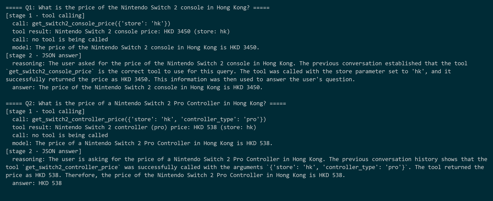
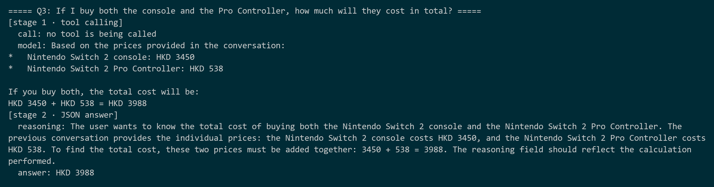

# Chapter 2 — Teaching the SLM to call tools (`basic_tool_calling.py`)

> **Part of the [study guide](./study_guide.md). Previous: [Chapter 1 — Your first local SLM](./01_basic_chat.md) · Next: [Chapter 3 — MCP client](./03_mcp_client.md)**

An LLM that only *talks* is limited: it answers from memory and makes up prices, dates, and facts (AI people call this "hallucinating"). The solution used by every modern AI assistant is **tool calling**: the model can ask your *code* to run a function, read the result, and then answer.

In this chapter, the model gets two pretend "price" tools and answers three questions — ending with a total price. Everything here uses **fake prices** (no internet yet). The internet enters in [Chapter 3](./03_mcp_client.md).

```
src/basic_tool_calling.py
```

---

## 2.1 The `@tool` decorator

nobodywho turns any Python function into a tool with `@tool`. You describe *when* to use it and *what* its parameters mean:

```python
@tool(
    description="""Gets the current price of the Nintendo Switch 2 console.
    Use this tool when the user asks about 
    the price of the Switch 2 console itself (not controllers).
    Returns the price and the store name.""",
    params={
    "store": """The region/store to check the price in.
    Use 'hk' for Hong Kong.
    """
    },
)
def get_switch2_console_price(store: str) -> str:
    """Return the mock price of the Nintendo Switch 2 console, only for Hong Kong."""
    if store != "hk":
        return """Invalid parameters. The only valid parameter is store='hk'.
    Please correct the parameters and call the tool again."""
    return f"Nintendo Switch 2 console price: HKD 3450 (store: {store})"
```

Three lessons packed in one function:

1. **The description is the "manual" the model reads.** It must say *when* to use the tool and *when not* to use it ("not controllers") — that is how the model picks the right tool between similar ones.
2. **`params` describes each argument.** The model fills these in; good descriptions make it choose correct values like `'hk'`.
3. **A tool never throws an error for bad input; it returns a message that explains the problem.** When the store is not `hk`, the function returns a polite "Invalid parameters… call the tool again." — the model *reads it as the tool result* and can fix its own mistake. This is done on purpose: we check the input inside the tool and keep the conversation going instead of stopping with an error.

The second tool has two parameters, and checks both:

```python
def get_switch2_controller_price(store: str, controller_type: str) -> str:
    """Return the mock price of a Nintendo Switch 2 Pro Controller, only for Hong Kong."""
    if store != "hk" or controller_type != "pro":
        return """Invalid parameters. The only valid parameters are store='hk' and controller_type='pro'.
    Please correct the parameters and call the tool again."""
    return f"Nintendo Switch 2 controller ({controller_type}) price: HKD 538 (store: {store})"
```

Reference: nobodywho tool calling docs — https://docs.nobodywho.ai/python/tool-calling/

---

## 2.2 Giving tools to a Chat

The `SLM` class gained one parameter, `tools`, and `invoke()` gained `tool_hint`:

```python
        self.chat = Chat(
            model=model,
            sampler=sampler,
            system_prompt=system_prompt,
            n_ctx=n_ctx,
            tools=tools or [],
        )
```

When `tools=[...]` is passed, nobodywho handles the **whole tool-calling loop for you**:

1. Send the question to the model.
2. If the model makes a *tool call* (which tool, which arguments), nobodywho runs the Python function.
3. The result is added to the chat as a special message with `role="tool"`.
4. Generation continues — the model now sees the result and writes its answer.

You will never see the behind-the-scenes tool-call text; you just read the final answer. But the *history* records everything, and that's how we look at it and reuse it.

### Reading the history

```python
    def build_chat_history(self) -> str:
        lines = []
        for msg in self.chat.get_chat_history():
            for call in msg.get("tool_calls") or []:
                fn = call["function"]
                lines.append(
                    f"Assistant called tool {fn['name']} with arguments {fn['arguments']}"
                )

            content = str(msg.get("content") or "").strip()
            if not content:
                continue
            if msg["role"] == "tool":
                lines.append(f"Tool {msg.get('name', 'unknown')} returned: {content}")
            else:
                lines.append(f"{msg['role'].capitalize()}: {content}")
        return "\n".join(lines)
```

The chat history is a list of message dicts (Python dictionaries). Assistant messages may carry `tool_calls` (name + arguments); tool results arrive as messages with `role="tool"`. `build_chat_history()` turns all of it into **one readable text** — this plain-text history is what we pass into the next stage.

---

## 2.3 The two-stage pattern (and a critical conflict)

The demo runs each question through **two different chats**:

```python
    tool_slm_sampler = SamplerBuilder().temperature(0.1).dist()

    tool_slm = SLM(
        model=model,
        system_prompt="You are a helpful assistant. Use the provided tools to answer questions.",
        n_ctx=100000,
        max_completion_tokens=1000,
        sampler=tool_slm_sampler,          # no JSON schema — plain sampler
        tools=[get_switch2_console_price, get_switch2_controller_price],
    )
```

**Stage 1 — the tool chat.** Uses the plain sampler and gets the tools. It talks freely.

```python
    json_slm_sampler = SamplerBuilder().temperature(0.1).constrain_with_json_schema(output_schema).dist()

    json_slm = SLM(
        model=model,
        system_prompt=json_system_prompt,
        n_ctx=100000,
        max_completion_tokens=1000,
        sampler=json_slm_sampler,          # JSON schema → beautiful summary
    )
```

**Stage 2 — the JSON chat.** Gets **no tools**, but a JSON schema. Its only job: read the previous conversation and produce a clean `{reasoning, answer}` summary.

> ⚠️ **The conflict we discovered (important!).** A JSON-schema sampler and tools **cannot be used at the same time**. The schema limits *every* token to the JSON grammar, and tool calls are written with special tokens that the grammar does not allow. Result: the model *wants* to call a tool (you can see it say so in `reasoning`) but makes **zero tool calls**. If you ever see a model "describing" a tool instead of calling it, this is why. Rule: **tools need the default sampler; JSON needs the schema sampler; never both at once.**

Reference: nobodywho sampling docs (SamplerBuilder) — https://docs.nobodywho.ai/python/

---

## 2.4 Hints: guiding a small model

Small models need more guidance than big ones. The demo adds a `tool_hint` after each question:

```python
        if tool_hint:
            user_prompt = f"{user_prompt}\n{tool_hint}"
```

and the main loop defines exactly what to say:

```python
    tool_hint = """(You MUST call one of the available tools to answer this question.
    For the console price: call get_switch2_console_price.
    For the controller price: call get_switch2_controller_price.
    Choose the tool that matches the question.)
    """
```

See what this does: it **names the tools and tells the model which tool to use for each kind of question**. Without this, the 2B model sometimes just answers from memory (making up a price). With it, tool selection is reliable.

The third question gets the opposite hint:

```python
    calc_hint = """(Do NOT call any tool.
    Read the prices from the Previous Conversation 
    and Provide the total price by adding the price of each item that the user wants to buy!
    .)
    """
```

---

## 2.5 The main loop

```python
    turns = [
        ("What is the price of the Nintendo Switch 2 console in Hong Kong?", 
        tool_hint, False),

        ("What is the price of a Nintendo Switch 2 Pro Controller in Hong Kong?", 
        tool_hint, False),

        ("If I buy both the console and the Pro Controller, how much will they cost in total?", 
        calc_hint, True),
    ]

    chat_history = ""
    for i, (question, hint, with_history) in enumerate(turns, 1):
        tool_slm.chat.reset_history()
        history = chat_history if with_history else ""
        tool_slm.invoke(question, chat_history=history, tool_hint=hint)
        turn_history = tool_slm.build_chat_history()
        chat_history = f"{chat_history}\n{turn_history}".strip()

        json_answer = json_slm.invoke(question, chat_history=chat_history)

        print_turn(i, question, tool_slm.chat, json_answer)
```

For each turn:

1. `reset_history()` — start the tool chat clean (small models tend to **copy the previous turn's pattern** — if turn 1 called the console tool, a fresh question may call the console tool again; resetting avoids that).
2. Run stage 1 with the right history and hint.
3. Add the readable history (`build_chat_history()`) to the growing `chat_history` text.
4. Run stage 2 (JSON summary) on the history collected so far.
5. `print_turn()` prints a neat two-stage report for the turn.

`print_turn()` reads through `chat.get_chat_history()` and prints every `call:` / `tool result:` / `model:` line, then reads and prints the stage-2 JSON.

---

## 2.6 Run it

```powershell
uv run --python ".venv" python -X utf8 src/basic_tool_calling.py
```

Expected output — Q1 and Q2:



Q3 (the total):



What to observe:

- **Q1:** `call: get_switch2_console_price({'store': 'hk'})` → tool result `HKD 3450` → the model answers with the real tool number.
- **Q2:** `call: get_switch2_controller_price({'store': 'hk', 'controller_type': 'pro'})` → `HKD 538`.
- **Q3:** `call: no tool is being called` — the hint worked — and the model adds: `3450 + 538 = 3988`.

Notice one thing about Q3: **the model did the arithmetic itself** (`HKD 3450 + HKD 538 = HKD 3988`) and got it right *this time*. Do not trust this pattern. In [Chapter 4](./04_mcp_tool_calling.md) you will see the same model fail simple sums repeatedly — which is why the final architecture moves arithmetic **into code** via an addition tool.

---

## 2.7 Experiments

1. **Break the hint.** Run Q1 with the controller hint instead of the console hint. Watch the model pick according to the hint (that's how strongly hints act).
2. **Invalid store.** Change Q1 to `... in France?` and watch the chain: tool call with `'fr'` → invalid-parameters message → the model reads the correction and answers properly. This shows why tools should return messages instead of throwing errors.
3. **The big conflict test.** Pass `sampler=json_slm_sampler` into `tool_slm`. Run. Count the tool calls — **zero**. Read the model's text: it *wants* to call the tool but cannot. Lesson learned.
4. **Try no tool_hint at all** for Q1. Sometimes the model calls the tool anyway, sometimes it makes up a price from memory. Repeat a few times to see how unstable the small model is.

---

## 2.8 What you learned / where this goes

- `@tool` + `Chat(tools=[...])` = the model can run your Python functions while answering.
- The chat history (calls + results) can be looked at — you can turn it into text and reuse it in a second chat.
- Tools and JSON schemas cannot be combined; use **two stages** with two chats.
- Small models need hints that name the tools and say which one to use.
- **Looking ahead:** trusting the model with math is risky. Code will take over.

Next: stop faking prices — connect **real MCP servers** that search the web and read pages: **[Chapter 3 — MCP client](./03_mcp_client.md)**.
