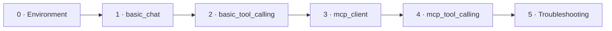

# Study Guide — Local SLM + MCP Web Search

> *A complete, beginner-friendly tutorial: from "what is a token?" to reproducing a fully local, zero-cost web-search AI pipeline with a small language model and MCP servers.*

**New to this repository?** Start with the [project README](../README.md) for the one-page overview, then come back here.

---

## What you will build

By the end of this guide you will have built, run, and understood this:

**One question goes in:**

> *"If I buy the Nintendo Switch 2 console and a Nintendo Switch 2 Pro Controller in Hong Kong, how much will they cost in total?"*

**And this comes out** — a real answer built from the *official store's live prices*, plus a complete Markdown run report:

> **The total cost is HKD 4238.**

The final run produces a file like [`output/run_20261018_152058.md`](../output/run_20261018_152058.md) — open it now to see your end goal: tables listing every MCP server, every tool call, every step ("who did what": code vs. the SLM), the extracted price data, and the final answer.

Everything runs **on your own computer**. No API keys. No cloud. No cost.

---

## The story of this project

We wanted a local AI assistant that can answer questions about current web data — the way big assistants "search the web" before answering. Building that by hand would mean writing and forever maintaining a full web-search + scraping stack (proxies, JavaScript challenges, anti-bot defenses…). Instead, this project **combines existing tools from the MCP ecosystem**:

- **DuckDuckGo MCP server** — free web search (`search`), no API key.
- **Playwright MCP server** — a real browser that reads pages `fetch_content`-style fetchers cannot: the official Nintendo HK store is protected by an AWS WAF JavaScript challenge, which blocks every plain HTTP fetcher (we verified this — see [Chapter 3.5](./03_mcp_client.md#35-the-discovery-that-shaped-the-project-fetch_content-is-not-enough)).

The tool combination becomes the "hands" of a **local small language model** (Gemma 4 E2B, compressed so it runs even without a GPU) — reproducing the "ask an LLM → it searches → it answers" experience at zero cost.

And one big honest lesson, documented in depth in [Chapter 4.6](./04_mcp_tool_calling.md#46-the-small-model-limitation-story): a 2B model is *not* a self-working agent that can plan and finish a whole task alone. It took rounds of redesign (a→b→c→d) before the architecture settled: **the SLM gets only the small text jobs; everything else is forced by code** — the *harness*. That discovery is half the value of this project.

---

## Learning path

Read in order. Each chapter is complete on its own: read the code, run it, check the screenshot, do the experiments.

| # | Chapter | What you build / learn | You will... |
|---|---|---|---|
| 0 | [Environment setup](./00_environment_setup.md) | Python, uv, Node.js, `@playwright/mcp`, the model file | Verify every piece is working |
| 1 | [Your first local SLM](./01_basic_chat.md) | `src/basic_chat.py` — running the model locally, JSON-forced answers, memory | Talk to a ~2B model on your machine |
| 2 | [Tool calling](./02_basic_tool_calling.md) | `src/basic_tool_calling.py` — `@tool`, the tool-calling loop, two-stage pattern | Make the model call Python functions |
| 3 | [MCP client](./03_mcp_client.md) | `src/mcp_client.py` — connecting servers, listing tools, the WAF discovery | Talk to real MCP servers |
| 4 | [The full pipeline](./04_mcp_tool_calling.md) | `src/mcp_tool_calling.py` — the code-first harness, price extraction, the md report | Reproduce the final output |
| 5 | [Troubleshooting](./05_troubleshooting.md) | Every trap we hit (encoding, OOM, WAF, prompts) | Debug like you've been here before |

Each chapter ends with **Experiments** — small on-purpose changes that break things, which teach more than any explanation. Do them.

---

## Vocabulary (plain-language glossary)

| Term | Meaning |
|---|---|
| **SLM / LLM** | A language model. This project's model (Gemma 4 E2B) is "small": ~2B parameters ("parameters" = numbers inside the model, more = smarter but heavier), compressed so it runs even without a GPU |
| **GGUF** | Single-file model format for running models locally. Our file is `UD-Q2_K_XL` — a compressed ~2-bit version, small enough to run on an ordinary CPU |
| **Token** | The unit models read/write (≈ ¾ of a word); all limits are in tokens |
| **Context (`n_ctx`)** | How many tokens the model can hold at once; bigger = heavier |
| **Sampler** | Rules for choosing the next token — randomness (`temperature`) and allowed output shape (JSON schema) |
| **JSON** | A common text format for structured data, like `{"name": "Chase", "answer": 42}`. Models can be forced to reply in this format |
| **Regex (regular expression)** | A text pattern you give the computer to find matching text, like "the text HKD followed by digits" |
| **Tool calling** | The model can request that *your code* run a function mid-answer |
| **MCP** | Model Context Protocol — a standard way for AI apps to use external tool servers ([modelcontextprotocol.io](https://modelcontextprotocol.io/)) |
| **API key** | A secret code that lets a program use a paid online service. This project needs none |
| **stdio transport** | The MCP client runs the server as a separate program and talks to it through that program's simple text channels (standard input/output) |
| **Harness** | Our plain-code layer that runs and controls every step in a fixed, repeatable way — the opposite of "letting the model make things up as it goes" |
| **WAF challenge** | A website security check requiring JavaScript execution; plain fetchers fail, real browsers pass |
| **Headless browser** | A real browser running without a visible window |

---

## Repository map

| Path | What it is | Study chapter |
|---|---|---|
| [`src/basic_chat.py`](../src/basic_chat.py) | Minimal chat with the local SLM | [Chapter 1](./01_basic_chat.md) |
| [`src/basic_tool_calling.py`](../src/basic_tool_calling.py) | Tool-calling + 2-stage JSON pattern (pretend data) | [Chapter 2](./02_basic_tool_calling.md) |
| [`src/mcp_client.py`](../src/mcp_client.py) | Connect to both MCP servers, list their tools | [Chapter 3](./03_mcp_client.md) |
| [`src/mcp_tool_calling.py`](../src/mcp_tool_calling.py) | The full harness: search → browse → extract → answer → report | [Chapter 4](./04_mcp_tool_calling.md) |
| [`output/run_*.md`](../output/) | Generated run reports (the final result you build toward) | [Chapter 4.9](./04_mcp_tool_calling.md#49-run-it--and-reproduce-the-output) |
| [`screenshot/`](../screenshot/) | Reference screenshots used in this guide | all |
| [`model/`](../model/) | Place the downloaded `.gguf` here | [Chapter 0](./00_environment_setup.md) |
| [`requirements.txt`](../requirements.txt) / [`project_setup.md`](../project_setup.md) | Python packages / short checklist of setup steps | [Chapter 0](./00_environment_setup.md) |

---

## Official references used by this guide

- MCP: [modelcontextprotocol.io](https://modelcontextprotocol.io/) · [Build an MCP client (official tutorial)](https://modelcontextprotocol.io/docs/develop/build-client) · [Python SDK](https://github.com/modelcontextprotocol/python-sdk)
- nobodywho (the engine that runs the model locally): [docs](https://docs.nobodywho.ooo/python/) · [tool calling docs](https://docs.nobodywho.ooo/python/tool-calling/) · [GitHub](https://github.com/nobodywho-ooo/nobodywho) · [PyPI](https://pypi.org/project/nobodywho/)
- DuckDuckGo MCP server: [GitHub](https://github.com/nickclyde/duckduckgo-mcp-server) · [PyPI](https://pypi.org/project/duckduckgo-mcp-server/)
- Playwright MCP: [GitHub](https://github.com/microsoft/playwright-mcp) · [npm](https://www.npmjs.com/package/@playwright/mcp) · [Playwright docs](https://playwright.dev/docs/getting-started-mcp)
- The model: [unsloth/gemma-4-E2B-it-qat-GGUF](https://huggingface.co/unsloth/gemma-4-E2B-it-qat-GGUF)
- The tools we install: [Python](https://www.python.org/downloads/) · [uv](https://docs.astral.sh/uv/) · [Node.js](https://nodejs.org/) · [VS Code](https://code.visualstudio.com/)

---

## How to use this guide

1. **Do Chapter 0 first, fully.** The check step there proves that all your tools work.
2. **If you cloned the repo, type nothing by hand** — every chapter refers to the real files. Read the code in the editor while reading the chapter.
3. **Run every script** and compare with the screenshots.
4. **Do the experiments.** They contain lessons we learned the hard way (especially the "break it on purpose" ones).
5. On any weird error: jump to [Chapter 5 — Troubleshooting](./05_troubleshooting.md).

Ready? Begin with **[Chapter 0 — Environment Setup](./00_environment_setup.md)**.
